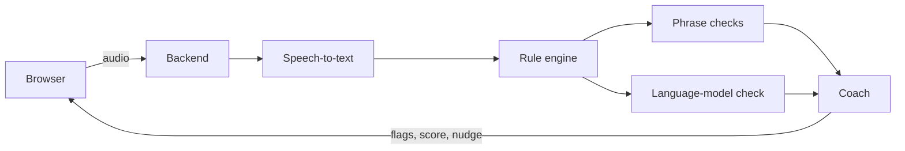

# Maryada

A live RBI-conduct coach for loan-recovery agents.

Demo with synthetic calls, not legal advice. Based on RBI/2026-27/223 (effective 1 Jan 2027).

**[Solution pitch](docs/PITCH.md)** · [Live demo](https://maryada.aiwithvineet.in) · [Architecture](docs/architecture.md) · [Evaluation notes](docs/EVAL-NOTES.md) · [Deployment](docs/deployment.md)

## What it does
- Shows a live transcript and underlines the words that break an RBI recovery-conduct rule, with the reason and a polite alternative.
- Keeps a running risk score from 0 to 100.
- Shows a coach card and speaks a short nudge.
- Ends with a Call report, and a Manager view across agents.

## Ways to try it
| Mode | What you need |
|---|---|
| Play a recorded run | Nothing. Replays a saved synthetic call. |
| Speak live | You speak as the agent, for up to 3 minutes. Your own Gnani key and language-model key. |
| Upload a recording | Planned. |

## How it works
The browser streams the agent's audio to the backend. Gnani speech-to-text turns each agent turn into text. The rule engine checks it with phrase rules and a language-model check, and the coach returns flags, a risk score and a short line to say. More in [docs/architecture.md](docs/architecture.md).



## Results
Measured on 30 synthetic calls with 35 labelled units, full engine, per unit.

| Condition | Strict precision | Strict recall |
|---|---|---|
| Clean audio | 75.0% | 85.7% |
| 20 dB noise | 73.2% | 85.7% |
| 10 dB noise | 66.0% | 88.6% |
| 5 dB noise | 56.4% | 88.6% |

Held-out recall on clean audio (10 calls): 81.8%. Details in [docs/EVAL-NOTES.md](docs/EVAL-NOTES.md).

## Quick start
Requires Python 3.12+ and Node 20+.
```bash
cp .env.example .env
cd backend && pip install -r requirements.txt && uvicorn app.main:app --reload
cd frontend && npm install && npm run dev
cd backend && pip install -r requirements-dev.txt && pytest -q
```
Live modes use the visitor's own keys, entered in Settings. Server keys are read only by local tools, and only when `SERVER_KEYS_ENABLED=true`.

## Tech stack
React, Vite and TypeScript; FastAPI and Python; Gnani Prisma V3.0 speech-to-text and Timbre V3.0 text-to-speech; deployed on Vercel and Render.

## Roadmap
- Upload a recording.
- Two-track dialer input for real calls.
- Lender-name matching for rule R2.

Built for Gnani.ai's Great Indian AI Internship Challenge.

## License
MIT. See [LICENSE](LICENSE).
