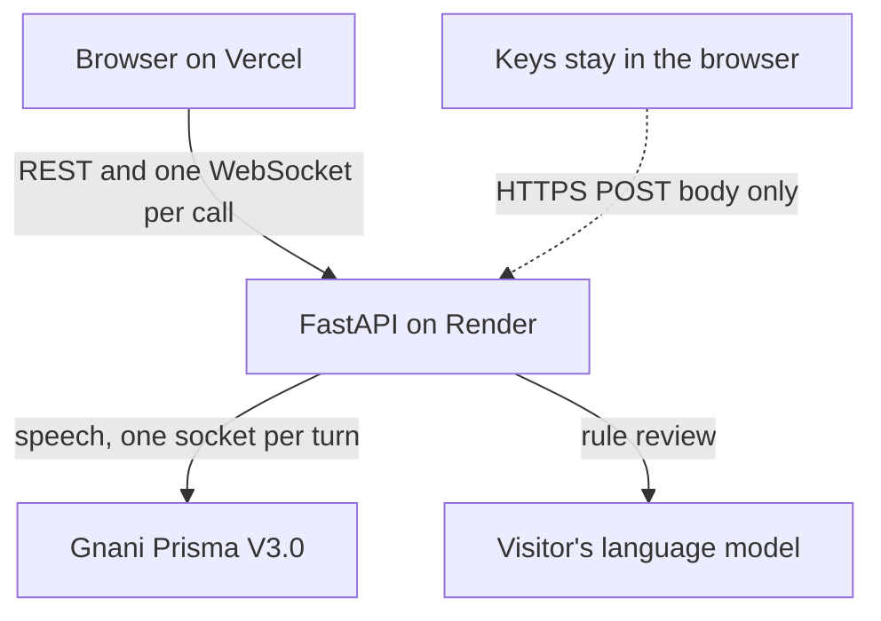
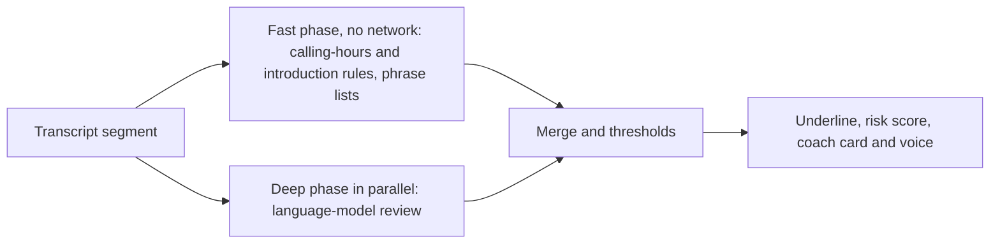

# Maryada

A live RBI-conduct coach for loan-recovery agents. It transcribes what the agent says, checks each sentence against six RBI conduct rules, underlines the exact words that break a rule, shows a polite alternative, keeps a 0 to 100 risk score, and for a serious breach speaks a short coaching line.

Demo with synthetic calls, not legal advice. Based on RBI/2026-27/223 (effective 1 Jan 2027).

[Live demo](https://maryada.aiwithvineet.in) · [Walkthrough video](https://youtu.be/-czfMx2bKXo) · [Solution pitch](docs/PITCH.md) · [Architecture](docs/architecture.md) · [Evaluation notes](docs/EVAL-NOTES.md) · [Deployment](docs/deployment.md)

https://github.com/user-attachments/assets/22518ba5-a056-4b9b-b9ea-f8d5b1e86480

## The problem
Recovery calls are usually reviewed after they end, when a bad line has already been said. RBI's conduct rules for recovery agents (no threats or humiliation, calls only 8 AM to 7 PM, no disclosure to third parties, no false statements) apply from 1 January 2027. Lenders need to catch breaches during the call. Calls are in Hindi, English or a mix, in Roman or Devanagari script, so an English keyword checker does not work.

## What it does
- Live transcript with the breaching words underlined, the rule and RBI reference, a reason and a polite alternative.
- Risk score from 0 to 100 (low below 30, medium 30 to 60, high above 60).
- Coach card plus a short spoken nudge for violations (at most 3 per call).
- Call report for each call and a Manager view across agents.
- Evaluation page that shows the accuracy and the weaknesses.

## Ways to try it
| Mode | What you need | What it really is |
|---|---|---|
| Recorded run | Nothing | Replays events saved from a real pipeline run. The rule engine does not run again, so it is identical every time. 11 of the 30 calls have one. |
| Speak live | Your own Gnani key and an OpenAI-compatible language-model key (Settings) | You speak as the agent for up to 3 minutes. The full pipeline runs on your microphone. Nothing is stored. |
| Upload a recording | n/a | Planned, not built. |

## System architecture

Every call is a list of numbered events (`seq`, `type`, `t_ms`, `data`) streamed over the WebSocket. A recorded run plays a saved list; Speak live produces the list as it hears the microphone, so the screen, the report and the reconnect logic are the same for both.

**Speak live path:** the browser downsamples the microphone to 8 kHz and streams 64 ms binary frames. The server splits speech into turns (a 1.2 s pause ends a turn), opens one Gnani Prisma realtime socket per turn, and sends each final transcript segment to the rule engine.

**Rule engine, two phases per segment:**

The fast phase draws a first flag at once. The deep phase updates the same flag in place or adds one. If the model is down, the fast results stand and the screen says so. Confidence of 0.75 or more is a violation, 0.45 to 0.75 is "needs review", lower is dropped.

If the connection drops, the browser reconnects and sends `resume` with the last sequence number it saw. The server replays the rest, so nothing is lost.

## The rules (rulebook rb-2026.11-v1)
| Rule | Checks | Decided by |
|---|---|---|
| R1 Calling hours | Calls only 08:00 to 19:00 | Deterministic rule |
| R2 Introduction | Agent names themselves, the lender, and says the call is recorded | Phrase rules on the second agent turn |
| R3 Abuse and threats | Threats, insults, humiliation | Phrase lists and language model |
| R4 Third-party disclosure | Telling a spouse or neighbour about the debt | Judged only when someone other than the borrower answered |
| R5 False statements | Fake notices, invented consequences | Phrase lists and language model |
| R6 Sensitive occasions | Pressing after a death or hospital stay | Always "needs review" |
| G1 Good practice | A clear polite greeting and similar | Positive signal, no risk effect |

## Technical choices and why
| Choice | Why |
|---|---|
| One WebSocket per call carrying numbered events | Two-way (audio in, events out), ordered, and resumable after a drop |
| Fast and deep phases in parallel | First flag appears at once; the model improves it; degrades gracefully if the model is down |
| Deterministic R1 and R2 | A calling-hours check should never be a guess |
| Phrase lists plus a language model | Rules alone found 57.1% of the labelled issues (20 of 35); the model finds paraphrased breaches |
| One speech socket per turn | Gnani allows one active REST request per key and sends no end marker; a socket per turn gives clean turn boundaries and a retry unit |
| Energy-based turn splitter | No extra dependency, easy to test; weaker in noisy rooms |
| Gnani Timbre used offline only | Call audio and the 21 coach clips are pre-generated; no runtime voice cost or delay |
| Bring-your-own-keys | The operator holds no production keys; visitors pay their own providers |
| Recorded runs as the default demo | Anyone can see the product without keys, with identical results |

## Privacy and keys
- Keys live in the browser (session storage by default, local storage only with "Remember on this device").
- They travel only in an HTTPS POST body, never in a URL, sit in server memory for the call, are redacted from logs, and are wiped when the call ends.
- The backend does see keys in plain text, because it makes the calls for the visitor.
- The visitor's model URL passes an SSRF guard: https only, public IPs only, the checked IP is the one connected to, no redirects.
- Speak live stores no audio, transcript or keys.

## Methodology: how it was measured
30 synthetic calls (300 turns, 8 fictional agents) were written with labels for which rule each issue breaks, then voiced with Gnani Timbre and passed through a phone-line filter. A scoring unit is one (call, agent turn, rule): 35 units. Each call runs through the same engine under four conditions: clean audio and noise at 20, 10 and 5 dB. Speech-to-text uses Gnani Prisma. The evaluation used Gnani REST, one request per turn, with the engine run once per complete agent turn, while the live app streams segments. Precision and recall are counted per unit, "strict" meaning needs-review flags do not count as found. Results are frozen in `data/eval/eval_results.json` and can be re-scored from committed caches without keys:
`python tools/run_eval.py --report --mode full --conditions clean`

| Condition | Strict precision | Strict recall |
|---|---|---|
| Clean audio | 75.0% | 85.7% |
| 20 dB noise | 73.2% | 85.7% |
| 10 dB noise | 66.0% | 88.6% |
| 5 dB noise | 56.4% | 88.6% |

Held-out (10 calls, 11 units), clean audio: precision 69.2%, recall 81.8%. With needs-review counted as found, clean-audio recall is 100%.

**Where it is weak.** Under noise the precision drop comes almost entirely from rule R2, which needs to hear the lender's name correctly: extra R2 flags go 0, 1, 8, 15 from clean to 5 dB. One label (c17 turn 7) and one engine rule (drop findings whose quote belongs to an earlier turn) were changed after seeing results; both are recorded in `data/eval/` and on the Evaluation page.

## Honest limits
- All calls are synthetic or your own microphone. Nothing was tested on real calls or real accents.
- 35 labelled units, one run per condition, one reviewer who also wrote the labels. The phrase lists were written while seeing all 30 scripts.
- Time from the end of a flagged phrase to the first flag, excluding network and paint: median 0.6 s and 95th percentile 3.0 s in the recorded runs (n=22). Not measured on the deployed site or in Speak live.
- No telephony, no speaker separation, no login, no durable storage. One free-plan container; first load can take about a minute; everything resets on restart.
- Speak live judges the agent only. Hindi, English and the mix (`hi-IN`) only.
- RBI clause references are from the rulebook file and have not been checked by a lawyer.

## Repository map
| Path | What is there |
|---|---|
| `backend/app/` | FastAPI app: `api/` endpoints, `session/` runner and microphone handling, `stt/` Gnani adapters, `rules/` engine, `security/` key handling |
| `frontend/src/` | React app: pages, components, stores, WebSocket and audio clients |
| `content/` | Rulebook, phrase lists, 30 call scripts, agents (YAML) |
| `data/` | Call audio, 11 recorded runs, evaluation results |
| `tools/`, `notebooks/` | Offline audio generation, recording and evaluation |
| `docs/` | Architecture, evaluation notes, deployment, pitch |

## Quick start
Requires Python 3.12+ and Node 20+.
```bash
cp .env.example .env
cd backend && pip install -r requirements.txt && uvicorn app.main:app --reload
cd frontend && npm install && npm run dev
cd backend && pip install -r requirements-dev.txt && pytest -q
```
Live modes use the visitor's own keys, entered in Settings. Server keys are read only by local tools, and only when `SERVER_KEYS_ENABLED=true`. 420 tests; there is no CI.

## Tech stack
Python 3.12, FastAPI, Pydantic v2, SQLite · React 19, Vite, TypeScript, Tailwind 4, Zustand · Gnani Prisma V3.0 (speech to text) and Timbre V3.0 (offline text to speech) · Vercel and Render.

## Roadmap
- Upload a recording.
- Two-track dialer input for real calls.
- Lender-name matching for rule R2 that survives noise.

Built solo by Vineet Patel for Gnani.ai's Great Indian AI Internship Challenge. [LinkedIn post](https://lnkd.in/p/dN7GwkfM)

## License
MIT. See [LICENSE](LICENSE).
