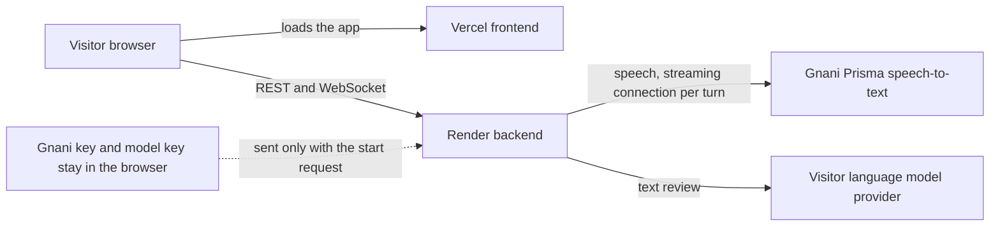
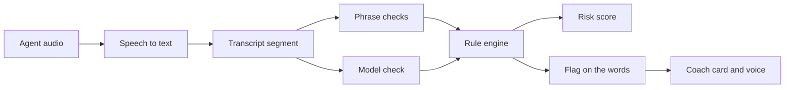
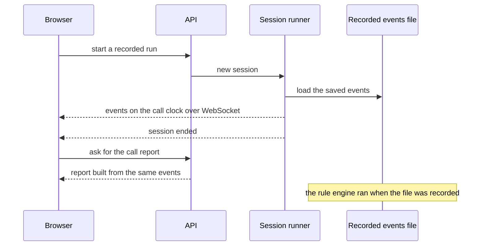
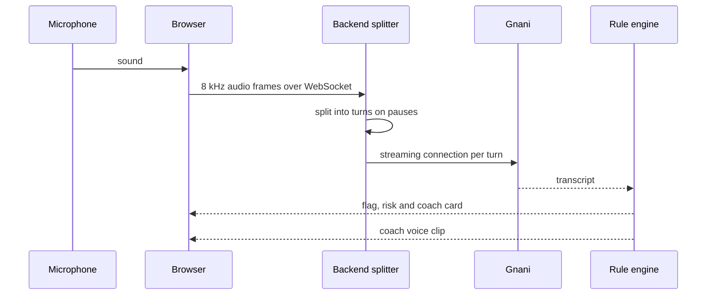
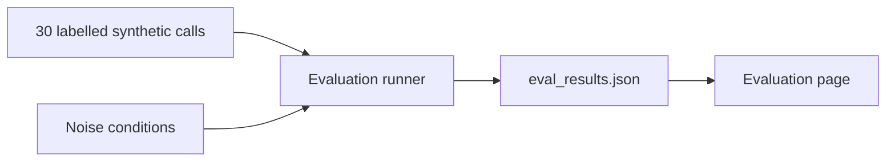

# Architecture

A five-minute read. Every box and number below comes from the code or from `data/eval/eval_results.json`.

## 1. What Maryada is

Maryada is a compliance coach for human loan-recovery agents. It transcribes what the agent says, checks each sentence against six RBI recovery-conduct rules, marks the words that breach a rule, shows a polite alternative, and keeps a 0 to 100 risk score for the call. For a serious breach it also plays a short spoken coaching line.

What it is not:
- It does not run on real phone calls today. Every call is synthetic or spoken into a laptop microphone.
- It stores nothing about visitors: no audio, no keys, and nothing at all from the microphone mode.
- It is not legal advice. The rules come from one source, RBI/2026-27/223.

There are two ways to run a call today. A recorded run replays saved results and needs no keys. Speak live uses the microphone and the visitor's keys. Sections 4 and 5 cover them in that order. A mode for uploading a recording is planned but not built.

## 2. The big picture

The backend is one Docker service on Render. It holds no Gnani key and no language-model key. The visitor types their own keys on the Settings page. The browser sends them once, in the request that starts a call, and the backend keeps them in memory for that call only. A recorded run needs no keys at all.

## 3. How a call is checked

Only the agent's turns are judged. The borrower's words are used as context. Each transcript segment is checked in two steps. The phrase checks answer at once and draw a first flag. The model check follows, and it updates the same flag in place or adds one. Very short, clean segments skip the model check. If the model is unavailable, the phrase checks still work and the screen says so.

The rule engine merges both results and turns a confidence into a label. At 0.75 or above it is a violation. From 0.45 up to 0.75 it is "needs review". Below 0.45 it is dropped. These two thresholds are fixed constants in `backend/app/rules/engine.py`, and the evaluation file records the same values. The coach card and voice appear for violations only, and the voice speaks at most 3 times per call.

| Rule | What it checks |
|---|---|
| R1 | Calling hours: recovery calls only between 08:00 and 19:00, judged from the call's start time |
| R2 | Within the first two agent turns, the agent gives their name, the lender and says the call is recorded |
| R3 | Abuse, threats and humiliation |
| R4 | Disclosure to a third party, judged only when someone other than the borrower answered |
| R5 | False or misleading statements |
| R6 | Sensitive occasions, always shown as needs review |
| G1 | Good practice, such as a clear greeting (a positive, not a violation) |

R1 and R2 are decided by rules on the whole turn, not by the model. R2 is rule-based, so garbled speech-to-text can make it miss a correct opening or flag a good one.

## 4. A recorded run

A recorded run replays events that were saved earlier from a real pass through the pipeline, so the rule engine does not run again. This is why it needs no keys and always shows the same result. When it ends, the browser opens the Call report, which the backend rebuilds from the saved events.

## 5. Speak live

The visitor speaks as the agent into the microphone. This mode needs the visitor's keys and is switched off unless it is enabled on both the server and the frontend.

- The browser resamples the microphone to 8 kHz, 16-bit mono, in frames of about 64 ms.
- The server ends a turn after 1.2 s of quiet and cuts any turn at 25 s.
- A call lasts up to 3 minutes (180 s) and then ends cleanly.
- A "who answered" selector (borrower, spouse or neighbour) feeds rule R4. A voice reminder asks for it once, after the agent's third turn, if it is still unset.
- Nothing is saved. The report is kept in memory for 30 minutes and then dropped.

## 6. How we measured it

The 30 calls are scripts turned into speech with text-to-speech. Each has a human label saying which rules it breaks. The runner sends them through the same engine, once per condition, and writes `data/eval/eval_results.json`, which the Evaluation page reads.

Results for the full engine on the 30 calls, counted per labelled unit:

| Condition | Precision | Recall | Recall counting needs review |
|---|---|---|---|
| Clean audio | 75% (30 correct, 10 extra flags) | 85.7% (30 of 35) | 100% (35 of 35) |
| 10 dB noise | 66.0% (31 correct, 16 extra flags) | 88.6% (31 of 35) | 100% (35 of 35) |
| 20 dB noise | 73.2% (30 correct, 11 extra flags) | 85.7% (30 of 35) | 97.1% (34 of 35) |
| 5 dB noise | 56.4% (31 correct, 24 extra flags) | 88.6% (31 of 35) | 97.1% (34 of 35) |

Under noise the precision drop comes from rule R2. It goes from 0 extra advisory flags on clean audio to 1 at 20 dB (in 1 call), 8 at 10 dB (in 8 calls) and 15 at 5 dB (in 15 calls). The two examples saved in the results file show the transcript with the lender name garbled or missing, so the introduction check fails. R2 has no model step. The model-based rules R3, R4 and R5 keep their recall at 10 dB and 5 dB. At 20 dB one R4 unit (c17, turn 7) is missed and R4 has one more extra flag than on clean audio. At 5 dB one R6 unit (c25, turn 7) is also missed by the review rule, so recall counting needs review is 34 of 35.

On the 10 held-out calls, clean audio gives 69.2% precision and 81.8% recall. With the model check switched off (phrase checks only), clean audio gives 100% precision and 63.6% recall (7 of 11), so the model check is what finds the missed cases. A flag with no matching label counts against precision.

## 7. Privacy and keys

- Keys stay in the browser: in the tab by default, or on that device if the visitor chooses "Remember on this device". They travel only in the request that starts a call, are never logged, and the backend wipes its copy when the call ends.
- Speak live writes nothing to disk or to the database: no audio, no transcript, no recording.
- The built-in synthetic calls do get a small SQLite log: session times, findings and the synthetic transcript turns. It lives inside the container and resets on every redeploy.
- Speak live events stay in memory for 30 minutes, only so the report can be shown, and are then dropped.
- Browser calls to the REST API are limited by CORS to the origins in `ALLOWED_ORIGINS`, plus any localhost port for development. CORS is enforced by the browser, not by a server block.
- The WebSocket has no origin check. Access depends on the session id, which is random and hard to guess.
- A custom model address is checked before the backend calls it, so it cannot point at internal addresses.

## 8. Limits and the path to a real call centre

- The calls are synthetic, so the numbers show the method works, not how it performs on real calls.
- The set is small: 30 calls and 35 labelled units, one run per condition. All four conditions (clean, 20 dB, 10 dB and 5 dB) have results for the full engine.
- R2 is rule-based and sensitive to speech-to-text errors. R6 is review-only by design.
- A real deployment would take two audio tracks from the dialer, one for the agent and one for the borrower. The engine already takes both sides and judges only the agent. What is not built is the dialer connection, storage, access control and a legal review of the rules.
- Speech in the evaluation uses Gnani's request-per-turn API, while the live app streams, so live transcripts can differ.
- An older keyed live pass over a built-in call's audio still exists in the code, but it is switched off and not offered on the Home page.
